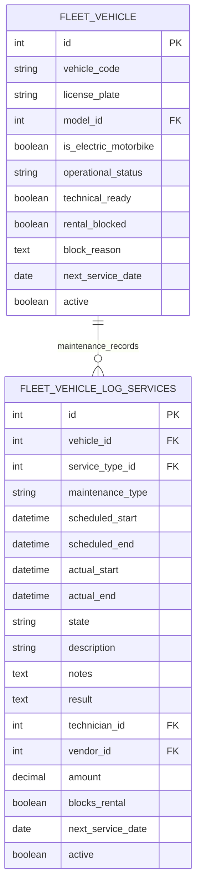

# ERD Fleet — phạm vi tuần 6

Module `motorbike_fleet_management`, phiên bản `19.0.3.1.0`. Hai model nghiệp vụ, List/Form và CRUD cơ bản. Trạng thái, điều kiện kỹ thuật, thời gian và mốc bảo dưỡng do người dùng nhập.

Sơ đồ trình bày dữ liệu nghiệp vụ cần quan tâm; các cột chuẩn Odoo về công ty, tiền tệ, audit và thông số xe vẫn tồn tại. `cost` là alias ORM của `amount`, không phải cột riêng. `technician_id` và `vendor_id` tái sử dụng `res.partner`; danh mục xe/dịch vụ tái sử dụng Fleet chuẩn.

`operational_status`: available/rented/inspection/maintenance. `state` bảo dưỡng: new/scheduled/running/done/cancelled. Người dùng chọn trực tiếp trên Form. Hai field ngày bảo dưỡng tiếp theo ở xe và hồ sơ không tự đồng bộ. `rental_blocked` và `blocks_rental` chỉ ghi nhận thông tin; chưa có cơ chế chặn đặt thuê.

Không có pin asset/assignment, maintenance plan riêng, ODO tùy chỉnh, bảng availability, chi tiết chi phí hoặc kho phụ tùng trong phạm vi custom.

Rental và Inspection sẽ liên kết tới `fleet.vehicle` khi triển khai tuần tích hợp. Bản tuần 6 chưa tạo các quan hệ đó, chưa có availability API/hook, workflow giao–trả hoặc tự động chuyển trạng thái.

Nguồn phạm vi: `ERP_Odoo (1).xlsx`, `Ke hoach Sprint!F13:I13`. Các nhiệm vụ Search/validation/workflow thuộc hàng 17 và tích hợp thuộc hàng 21 được để lại cho tuần sau.
