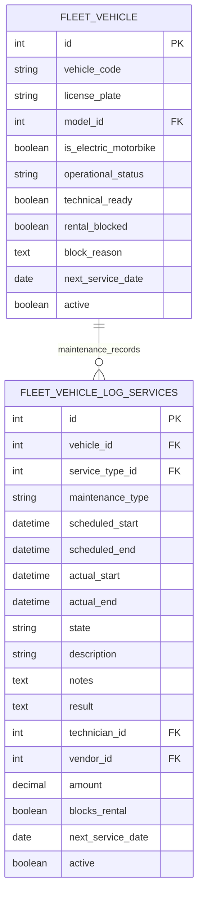

# ERD Fleet — cấu trúc tối giản, logic đến tuần 7

Module `motorbike_fleet_management`, phiên bản `19.0.4.0.0`. Tuần 7 thêm Search/Kanban, validation và luồng bảo dưỡng; không thêm cột/bảng nghiệp vụ. Sơ đồ Mermaid dưới đây mô tả model đang chạy; bản DBML bàn giao vẫn tạm bỏ các trường chờ giáo viên chốt.

Sơ đồ trình bày dữ liệu nghiệp vụ cần quan tâm; các cột chuẩn Odoo về công ty, tiền tệ, audit và thông số xe vẫn tồn tại. `cost` là alias ORM của `amount`, không phải cột riêng. `technician_id` và `vendor_id` tái sử dụng `res.partner`; danh mục xe/dịch vụ tái sử dụng Fleet chuẩn.

`operational_status`: available/rented/inspection/maintenance. `state` bảo dưỡng: new/scheduled/running/done/cancelled, cập nhật bằng nút có validation. Bắt đầu bảo dưỡng chặn thuê chuyển xe sang maintenance; kết thúc chuyển về inspection khi không còn bảo dưỡng chạy chặn. Xác nhận kỹ thuật riêng đưa xe về available. Hồ sơ hoàn thành gần nhất có next_service_date cập nhật mốc xe. `rental_blocked` vẫn là khóa chủ động độc lập. Chưa có cơ chế kiểm tra đặt thuê theo khoảng thời gian.

Không có pin asset/assignment, maintenance plan riêng, ODO tùy chỉnh, bảng availability, chi tiết chi phí hoặc kho phụ tùng trong phạm vi custom.

Rental và Inspection sẽ liên kết tới `fleet.vehicle` khi triển khai tuần 8. Bản hiện tại chưa tạo các quan hệ đó, chưa có availability API/hook hoặc workflow giao–trả. ODO chuẩn được kiểm tra không âm/không giảm theo ngày, không thêm cột hay model ODO mới.

Nguồn phạm vi: `ERP_Odoo (1).xlsx`, `Ke hoach Sprint!F17:I17`. Tích hợp hàng 21 để lại tuần 8; chưa triển khai.
