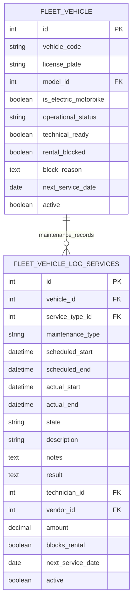

# ERD Fleet — cấu trúc tối giản, tích hợp tuần 8

Module `motorbike_fleet_management`, phiên bản `19.0.5.1.0`. Tuần 8 thêm phương thức giao/trả và kiểm tra lịch bảo dưỡng; không thêm cột/bảng nghiệp vụ. Bản 19.0.5.1.0 bổ sung UNIQUE mã xe theo Word nhóm trưởng; trạng thái/kỹ thuật chỉ đọc trên form. Sơ đồ Mermaid dưới đây mô tả model đang chạy; bản DBML bàn giao vẫn tạm bỏ các trường chờ giáo viên chốt.

Sơ đồ trình bày dữ liệu nghiệp vụ cần quan tâm; các cột chuẩn Odoo về công ty, tiền tệ, audit và thông số xe vẫn tồn tại. `cost` là alias ORM của `amount`, không phải cột riêng. `technician_id` và `vendor_id` tái sử dụng `res.partner`; danh mục xe/dịch vụ tái sử dụng Fleet chuẩn.

`operational_status`: available/renting/pending_inspection/maintenance. `state` bảo dưỡng: new/scheduled/running/done/cancelled, cập nhật bằng nút có validation. Bắt đầu bảo dưỡng chặn thuê chuyển xe sang maintenance; kết thúc chuyển về pending_inspection khi không còn bảo dưỡng chạy chặn. Xác nhận kỹ thuật riêng đưa xe về available. Hồ sơ hoàn thành gần nhất có next_service_date cập nhật mốc xe. `rental_blocked` vẫn là khóa chủ động độc lập. Fleet kiểm tra điều kiện kỹ thuật, khóa thuê và lịch bảo dưỡng theo thời gian; Rental kiểm tra thêm hợp đồng trùng lịch.

Không có pin asset/assignment, maintenance plan riêng, ODO tùy chỉnh, bảng availability, chi tiết chi phí hoặc kho phụ tùng trong phạm vi custom.

Rental/Operations liên kết tới xe và gọi phương thức Fleet theo `handoff/Fleet_Integration_Week8.md`. Repo này chưa chứa model của hai module đó nên không khai báo quan hệ giả. ODO chuẩn có validation và ghi nhận qua giao/trả; không khai báo lại field hoặc bảng ODO custom.

DBML nghiệp vụ hiện hành: `handoff/fleet_minimal/Fleet_Week8.dbml`, giữ hãng/dòng xe và tạm ẩn các trường chờ giáo viên chốt. Không đổi các snapshot bàn giao tuần 6.
